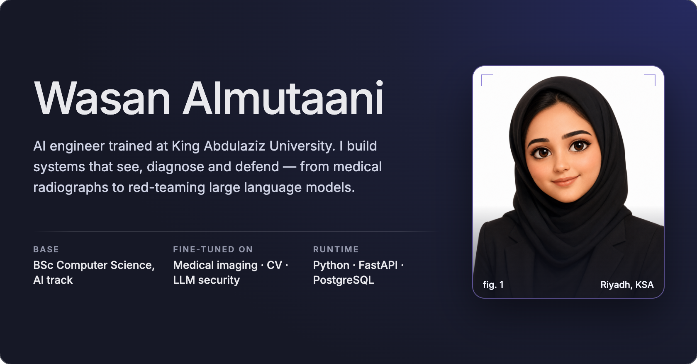
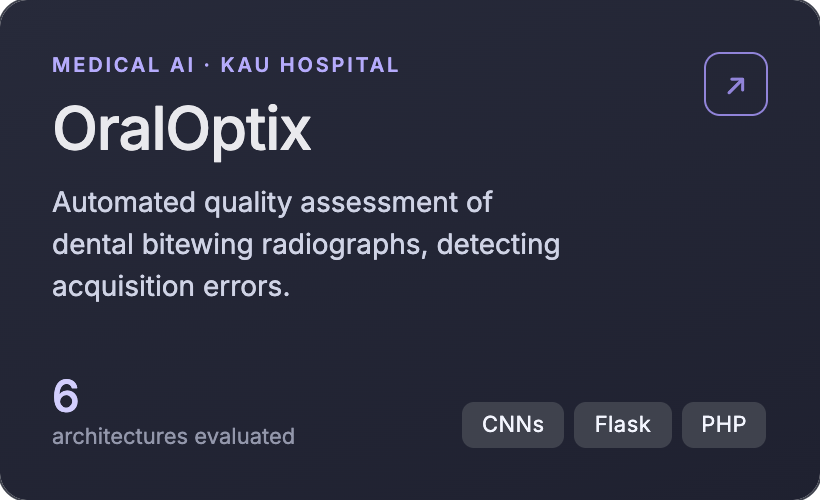
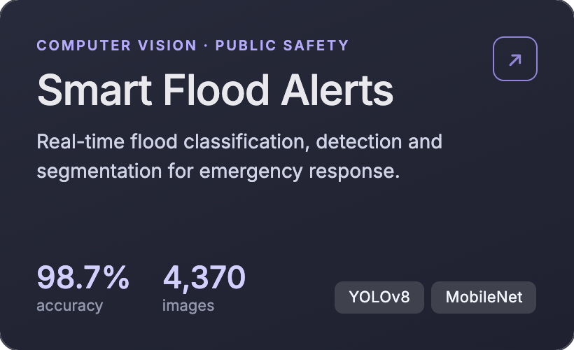
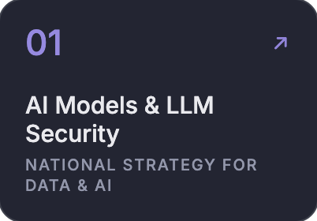
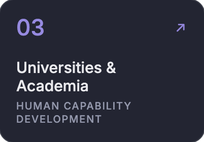
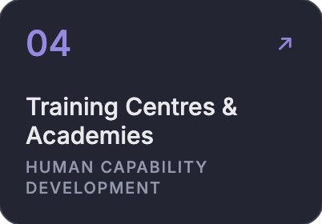
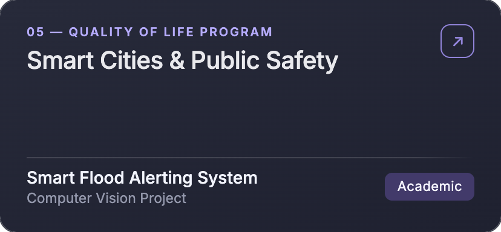
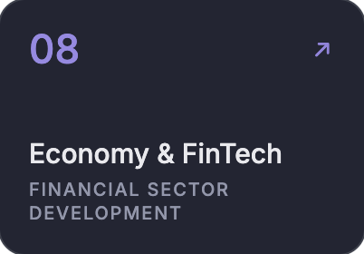
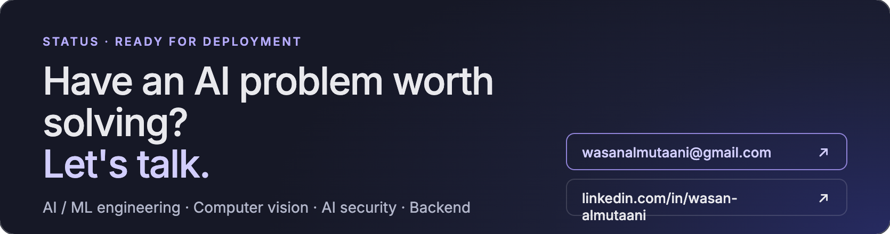

  
  

## Featured deployments

## Deployment sectors
Projects mapped to Saudi Vision 2030 programs. Each card jumps to its table.

  
  
  
  
  
  
  
  

<!--
  HOW TO ADD A PROJECT
  Paste a row into the matching table:
  | [Project name](https://github.com/WASAN-ALMUTAAN1/repo) | Organization | Org type | One-line result | Stack |
  Org types: University · University hospital · Research centre · Training academy · Government · Company
  Delete the "Open slot" row once that sector has a real project.
-->

### AI Models & LLM Security
`National Strategy for Data & AI`

| Project | Organization | Type | Result | Stack |
|---|---|---|---|---|
| [HexaGuard](https://github.com/WASAN-ALMUTAAN1?tab=repositories) | Saudi Digital Academy × WeCloudData | Training academy | LLM red-teaming: 9 capabilities, 8 provider connectors, OWASP LLM Top 10 risk scoring | FastAPI · Next.js · TypeScript |

### Healthcare & Medical Research
`Health Sector Transformation Program`

| Project | Organization | Type | Result | Stack |
|---|---|---|---|---|
| [OralOptix](https://github.com/WASAN-ALMUTAAN1?tab=repositories) | King Abdulaziz University Hospital | University hospital | Automated bitewing radiograph quality assessment; 6 deep learning architectures evaluated | CNNs · Flask · PHP |
| [Research Centre Data Platform](https://github.com/WASAN-ALMUTAAN1?tab=repositories) | King Fahd Medical Research Center | Research centre | Replaced Excel workflows with a PostgreSQL platform: 16 modules, 80+ data fields | PostgreSQL · Web systems |

### Universities & Academia
`Human Capability Development Program`

| Project | Organization | Type | Result | Stack |
|---|---|---|---|---|
| [Edvia Training Program](https://linkedin.com/in/wasan-almutaani) | Deanship of Admission & Registration, KAU | University | Supported 36 cooperative-training students across 3 technical tracks | Mentoring · Reporting |

### Training Centres & Academies
`Human Capability Development Program`

| Project | Organization | Type | Result | Stack |
|---|---|---|---|---|
| [Python Software Development Bootcamp](https://github.com/WASAN-ALMUTAAN1?tab=repositories) | Saudi Digital Academy / WeCloudData | Training academy | Project-based full-stack + AI training; delivered the HexaGuard client capstone | React · FastAPI · Docker |

### Smart Cities & Public Safety
`Quality of Life Program`

| Project | Organization | Type | Result | Stack |
|---|---|---|---|---|
| [Smart Flood Alerting System](https://github.com/WASAN-ALMUTAAN1?tab=repositories) | Computer Vision Project | Academic | 98.7% accuracy (MobileNet), 0.92 mAP50 (YOLOv8) on 4,370 images | YOLOv8 · MobileNet · Flask |

### Government & Digital Services
`Digital Government`

| Project | Organization | Type | Result | Stack |
|---|---|---|---|---|
| _Open slot_ | — | — | Accepting projects in this sector | — |

### Energy & Sustainability
`Saudi Green Initiative`

| Project | Organization | Type | Result | Stack |
|---|---|---|---|---|
| _Open slot_ | — | — | Accepting projects in this sector | — |

### Economy & FinTech
`Financial Sector Development Program`

| Project | Organization | Type | Result | Stack |
|---|---|---|---|---|
| _Open slot_ | — | — | Accepting projects in this sector | — |

<b>Certifications</b>

- PCEP™ Certified Entry-Level Python Programmer — Python Institute · 2026
- Python Software Development Engineering Bootcamp — Saudi Digital Academy / WeCloudData · 2026
- Python Basics · Functions, Files & Dictionaries · Data Collection & Processing — University of Michigan · 2025
- Mathematics for Machine Learning & Data Science — DeepLearning.AI · 2025

## Runtime

**Computer vision** CNNs · YOLO · classification · detection · segmentation
**LLM security** red-teaming · prompt injection · jailbreak evaluation · risk scoring

