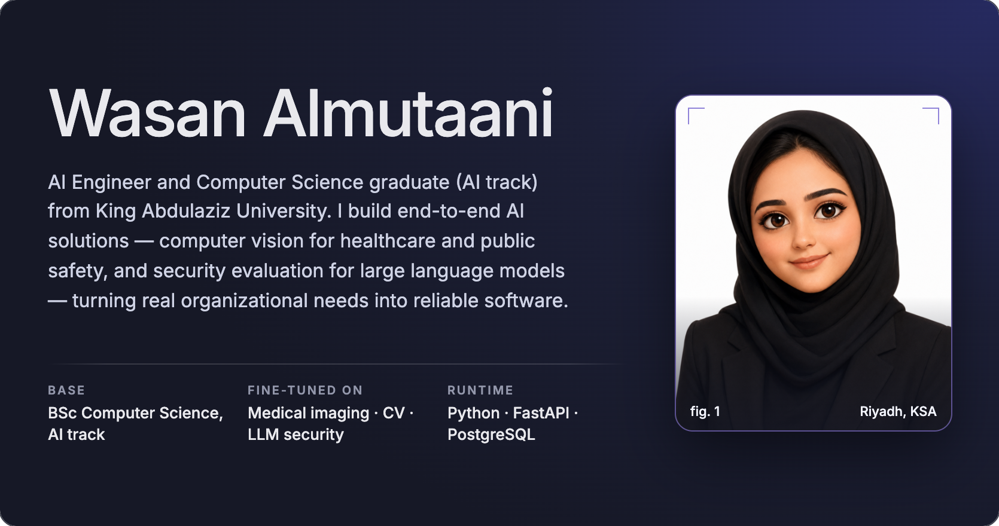

  
  

## Featured deployments

<a href="https://github.com/WASAN-ALMUTAAN1/Hexaguard">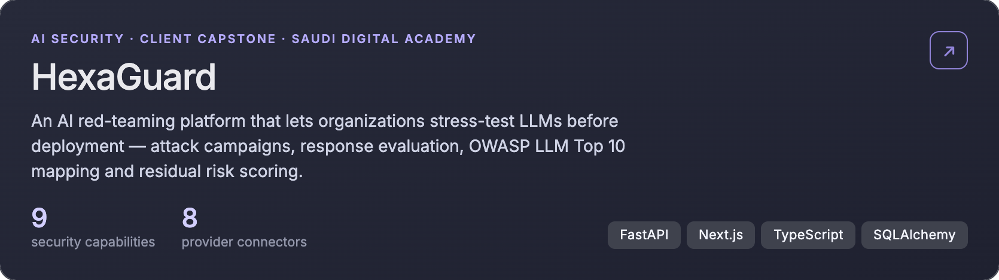</a>

## Sectors · Saudi Vision 2030

<a href="https://github.com/WASAN-ALMUTAAN1/Hexaguard">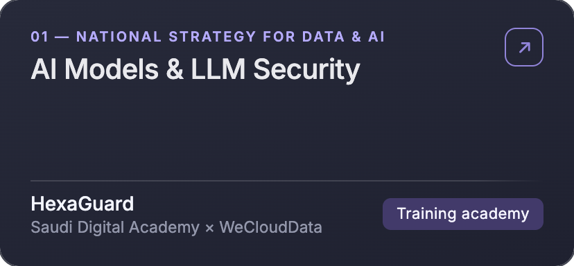</a>
<a href="https://github.com/WASAN-ALMUTAAN1/OralOptix-AI-Bitewing-Quality-Assessment">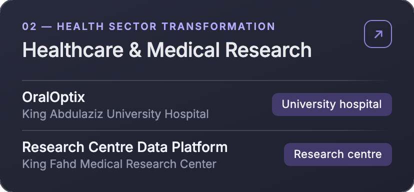</a>
<a href="https://linkedin.com/in/wasan-almutaani">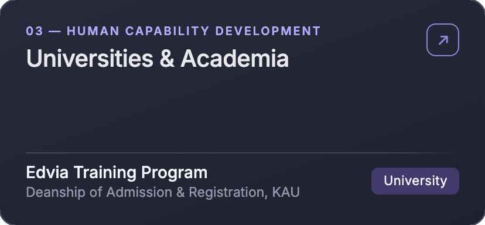</a>
<a href="https://github.com/WASAN-ALMUTAAN1/Hexaguard">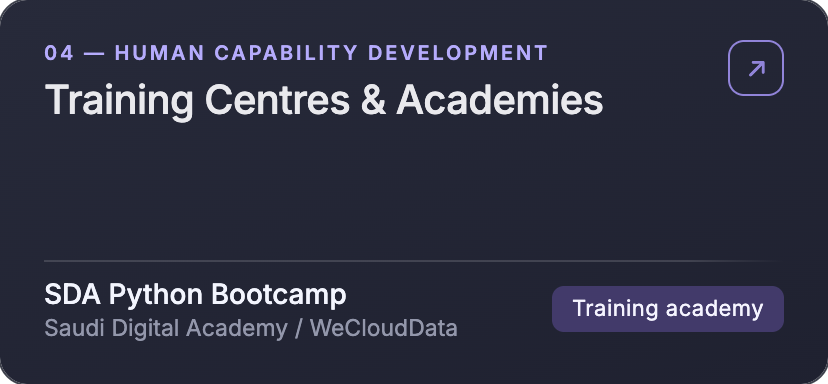</a>

<a href="https://github.com/WASAN-ALMUTAAN1?tab=repositories">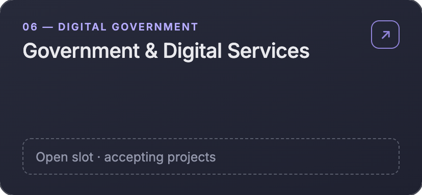</a>
<a href="https://github.com/WASAN-ALMUTAAN1?tab=repositories">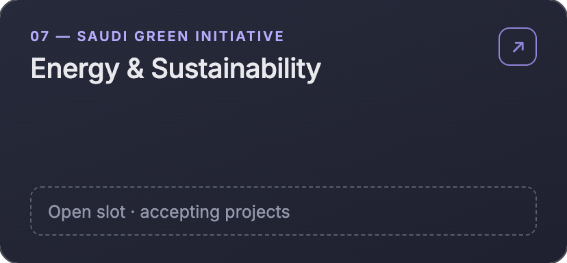</a>
<a href="https://github.com/WASAN-ALMUTAAN1?tab=repositories">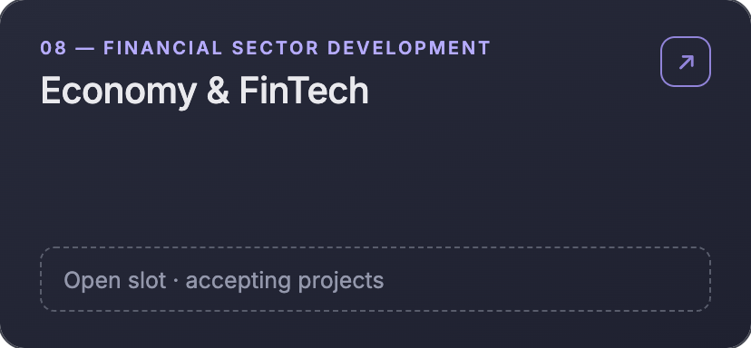</a>

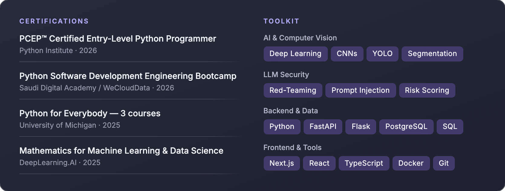

<a href="mailto:wasanalmutaani@gmail.com">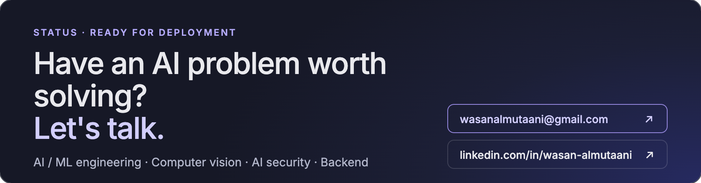</a>
